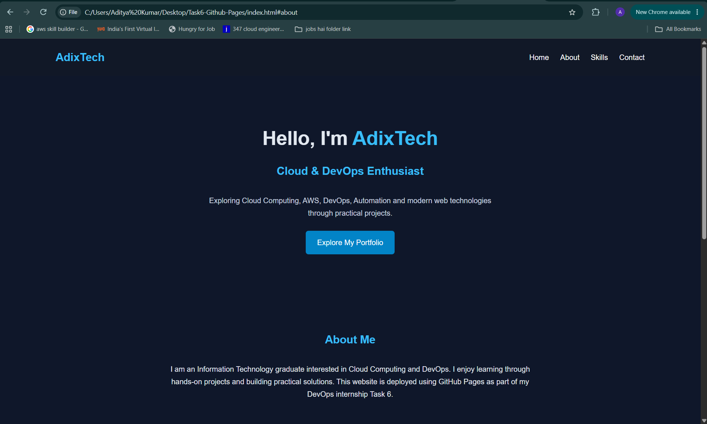
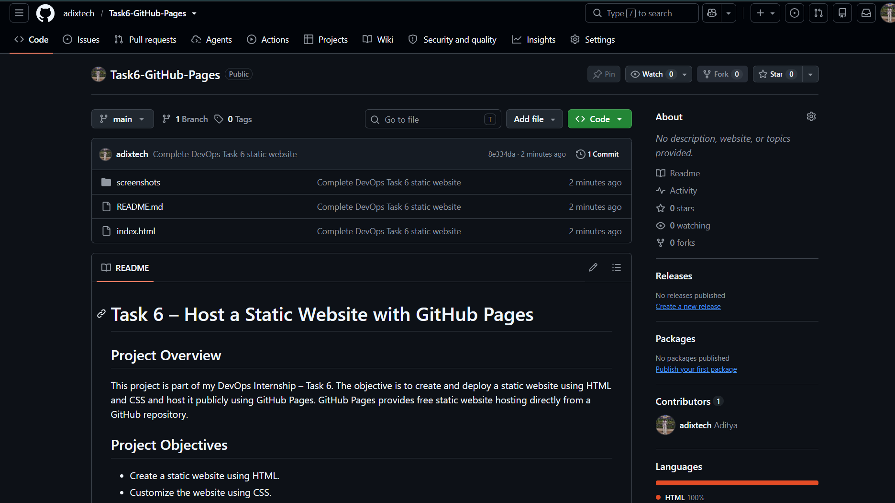
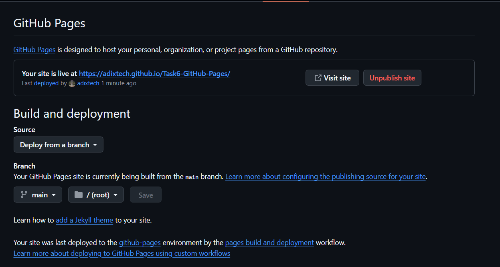
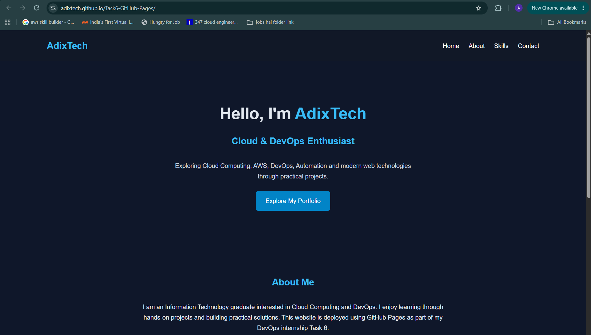
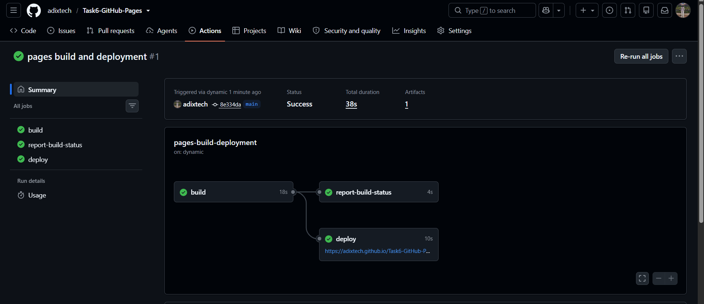

# Task 6 – Host a Static Website with GitHub Pages

## Project Overview
This project is part of my DevOps Internship – Task 6.
The objective is to create and deploy a static website using HTML and CSS and host it publicly using GitHub Pages.
GitHub Pages provides free static website hosting directly from a GitHub repository.

## Project Objectives
- Create a static website using HTML.
- Customize the website using CSS.
- Upload project files to GitHub.
- Configure GitHub Pages.
- Deploy the website using the main branch.
- Access and verify the live website through a public URL.

## Technologies Used
| Technology | Purpose |
|---|---|
| HTML5 | Website structure |
| CSS3 | Website styling and responsive layout |
| Git | Version control |
| GitHub | Source code repository |
| GitHub Pages | Static website hosting |
| VS Code | Code editor |

## Website Features
- Responsive website layout
- Navigation menu
- Home section
- About section
- Technical skills section
- Contact section
- Custom dark theme
- CSS hover effects
- Mobile-friendly layout

## Project Structure
```text
Task6-GitHub-Pages/
│
├── index.html
├── README.md
└── screenshots/
    ├── 01-local-website.png
    ├── 02-github-repository.png
    ├── 03-github-pages-settings.png
    ├── 04-live-website.png
    └── 05-deployment-verification.png
```
## Local Setup and Execution

1. Clone the repository:
```bash
git clone https://github.com/adixtech/Task6-GitHub-Pages.git
```
2. Navigate to the project directory:
```bash
cd Task6-GitHub-Pages
```
3. Open the project in VS Code:
```bash
code .
```
4. Open `index.html` in a web browser to view the website locally.

## Git Commands Used
Initialize the repository (only if not already initialized):
```bash
git init
```

Check project status:
```bash
git status
```

Add project files:
```bash
git add .
```

Commit changes:
```bash
git commit -m "Complete Task 6 GitHub Pages deployment"
```

Rename the branch:
```bash
git branch -M main
```

Connect the GitHub repository:
```bash
git remote add origin https://github.com/adixtech/Task6-GitHub-Pages.git
```

Push code to GitHub:
```bash
git push -u origin main
```

For future updates:
```bash
git add .
git commit -m "Update website"
git push
```
## GitHub Pages Deployment Steps
1. Create a new GitHub repository named `Task6-GitHub-Pages`.
2. Push the project files to the `main` branch.
3. Open the repository on GitHub.
4. Navigate to Settings.
5. Select Pages from the sidebar.
6. Under Build and deployment, select Deploy from a branch.
7. Select the `main` branch.
8. Select the `/ (root)` folder.
9. Click Save.
10. Wait for GitHub Pages to publish the website.
11. Open the generated public website URL and verify the deployment.

## Deployment Details
**GitHub Repository:**  
https://github.com/adixtech/Task6-GitHub-Pages

**Live Website:**  
https://adixtech.github.io/Task6-GitHub-Pages/

## Screenshots and Evidence
Screenshots will be added after completing each deployment stage.
1. Local website execution
2. GitHub repository and uploaded files
3. GitHub Pages configuration
4. Successful deployment
5. Live website verification

## Learning Outcomes
Through this task, I learned:

- How to create a static website using HTML and CSS.
- How to use Git for version control.
- How to upload and maintain code using GitHub.
- How to configure GitHub Pages.
- How to deploy and verify a publicly accessible static website.

## Interview Questions and Answers

**1. What is GitHub Pages?**
GitHub Pages is a free hosting service that allows users to publish static websites directly from a GitHub repository.

**2. Can GitHub Pages host dynamic applications?**
No. GitHub Pages supports static content such as HTML, CSS and JavaScript. It does not directly run backend applications or server-side code.

**3. What are the limitations of GitHub Pages?**
It is designed for static websites and has publishing size, bandwidth and build limits.

**4. How do you update a website hosted on GitHub Pages?**
Update the source files, commit the changes and push them to the configured branch. GitHub Pages will publish the updated website.

**5. What happens when you delete the repository?**
The website hosted from that repository will no longer be available through its GitHub Pages URL.

**6. What is the default file that loads when someone visits a website?**
Usually `index.html` is the default entry page.

**7. Can we use a custom domain with GitHub Pages?**
Yes. GitHub Pages supports custom domains when DNS and repository settings are configured correctly.

## Conclusion
Successfully completing this project demonstrates the basic process of creating, version-controlling and deploying a static website using GitHub Pages.

This project helped me understand the fundamentals of website hosting and Git-based deployment as part of my DevOps learning journey.

---

**Project:** DevOps Internship – Task 6  
**Developer:** AdixTech  
**GitHub:** https://github.com/adixtech

## Deployment Evidence
### 1. Local Website


### 2. GitHub Repository


### 3. GitHub Pages Configuration


### 4. Live Website


### 5. Successful Deployment
